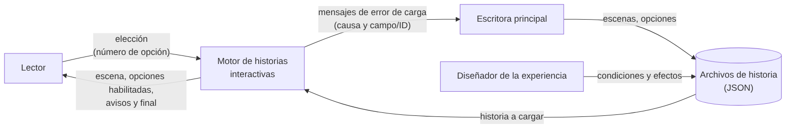
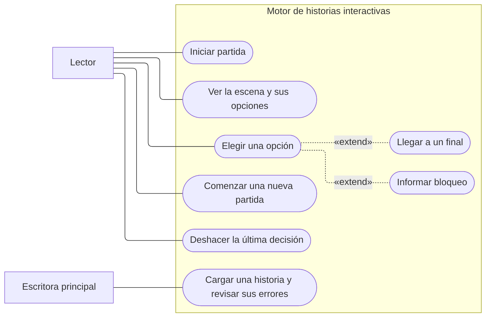
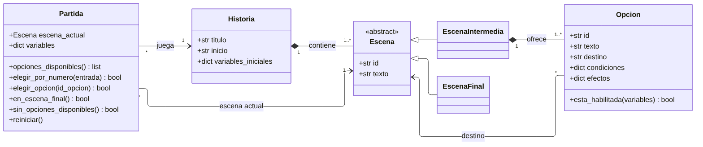
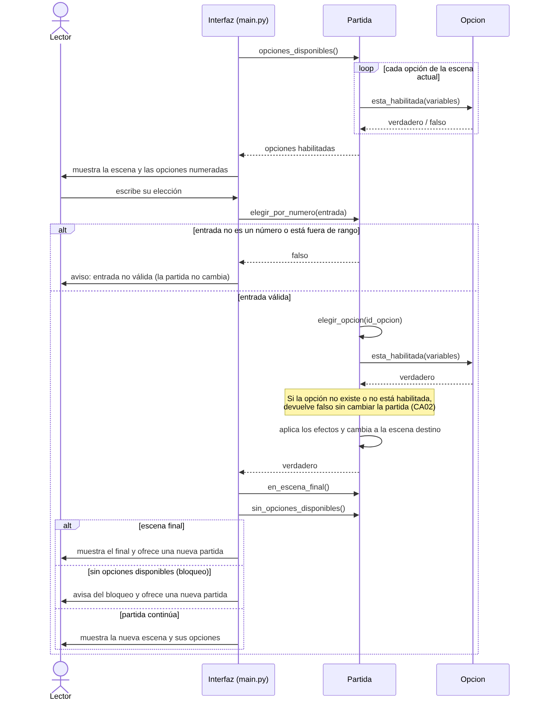
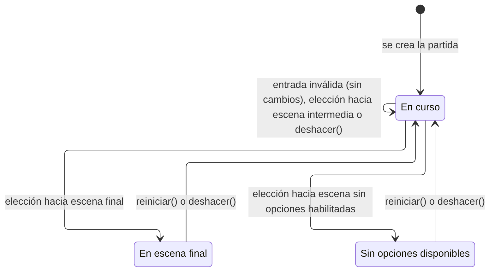
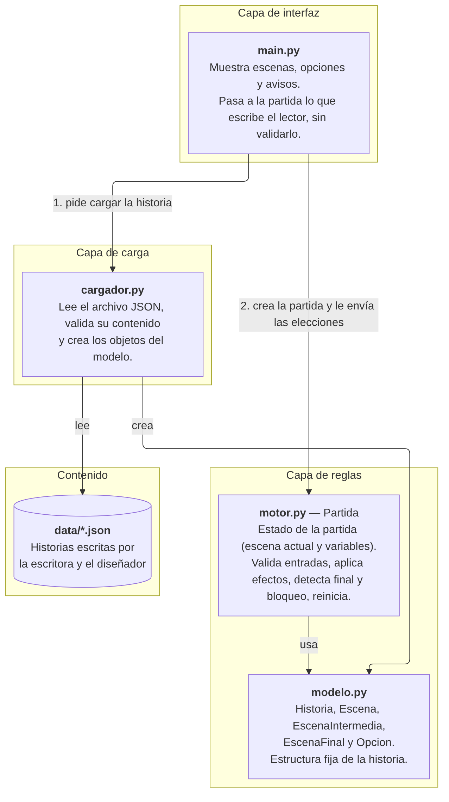

# Motor de historias interactivas

Motor de consola que carga historias interactivas desde archivos JSON, valida su contenido y permite jugarlas: el lector elige opciones, las decisiones cambian lo que aparece después y cada historia puede tener varios finales. Proyecto del parcial práctico de Ingeniería de Software, con la historia **"La última transmisión"**.

**Integrante:** Alan Chiquillo Torres

## Versiones requeridas
- Python 3.11 (probado con Python 3.11.9 en Windows)
- pytest 8.3.3 (solo para ejecutar las pruebas; se instala dentro de un entorno virtual, ver Instalación)

El motor solo usa la biblioteca estándar de Python (`json`, `sys`, `os`).

## Instalación
El proyecto se entrega en el archivo `Parcial_ChiquilloAlan.zip`. No requiere internet para jugar.

1. **Descomprimir** el archivo ZIP (clic derecho → *Extraer todo…*).
2. **Abrir una consola en la carpeta descomprimida**, la que contiene `README.md`, `src/` y `data/`.
   En Windows: abrir la carpeta en el Explorador, escribir `cmd` en la barra de direcciones y pulsar Enter.
3. **Comprobar que Python está instalado** (debe mostrar 3.11 o superior):
   ```
   python --version
   ```
   Si no está instalado, descargarlo desde python.org y marcar la opción *Add Python to PATH* durante la instalación.
4. **Crear el entorno virtual** (solo la primera vez):
   ```
   python -m venv .venv
   ```
5. **Activar el entorno virtual** (cada vez que se abra una consola nueva):

   | Consola | Comando |
   |---|---|
   | Símbolo del sistema (`cmd`) | `.venv\Scripts\activate` |
   | PowerShell | `.venv\Scripts\Activate.ps1` |
   | Mac o Linux | `source .venv/bin/activate` |

   Cuando el entorno está activo, la consola muestra `(.venv)` al inicio de la línea.
6. **Instalar la dependencia de las pruebas** dentro del entorno:
   ```
   python -m pip install -r requirements.txt
   ```

### Por qué un entorno virtual
El entorno virtual (`.venv`) es una carpeta dentro del proyecto con su propia copia de Python y sus propias bibliotecas. Así `pytest` se instala solo para este proyecto: no se mezcla con lo que ya tenga instalado el equipo donde se revisa y no cambia la versión de `pytest` de otros proyectos. El motor solo usa la biblioteca estándar, por lo que el entorno solo es necesario para ejecutar las pruebas; aun así se recomienda usarlo para todos los comandos.

La carpeta `.venv` no se incluye en el ZIP ni en el repositorio (está en `.gitignore`), porque depende del equipo donde se crea; cada persona la crea con el paso 4.

### Si PowerShell no permite activar el entorno
Si al activar aparece un error que dice que la ejecución de scripts está deshabilitada, hay dos opciones que no requieren cambiar la configuración del equipo:
- Abrir la consola con `cmd` (paso 2) y activar con `.venv\Scripts\activate`.
- No activar el entorno y usar su Python directamente, anteponiendo `.venv\Scripts\` a cada comando. Por ejemplo:
  ```
  .venv\Scripts\python -m pip install -r requirements.txt
  .venv\Scripts\python src/main.py
  .venv\Scripts\python -m pytest -v
  ```

El repositorio también está disponible en GitHub: https://github.com/8alanct-hub/sistema_de_historias_interectativas

## Ejecución
Siempre desde la carpeta descomprimida del proyecto y con el entorno virtual activado:

| Qué | Comando |
|---|---|
| Jugar "La última transmisión" | `python src/main.py` |
| Jugar la segunda historia ("El último algoritmo") | `python src/main.py data/segunda_historia.json` |
| Cargar cualquier otra historia | `python src/main.py ruta/al/archivo.json` |
| Ver el mensaje de un archivo con errores (destino inexistente) | `python src/main.py data/error_destino_inexistente.json` |
| Ejecutar las pruebas | `python -m pytest -v` |
| Guardar el registro de las pruebas (PowerShell) | `python -m pytest -v \| Out-File -Encoding utf8 docs/resultado_pruebas.txt` |

Si `python` no se reconoce como comando en Windows, use `py` en su lugar.

## Cómo jugar
- Escriba el **número** de la opción y pulse Enter.
- **0** deshace la última decisión (aparece solo cuando hay algo que deshacer; un solo nivel).
- En un final, **1** comienza una nueva partida y **0** deshace la última decisión.
- **Ctrl + C** cierra el programa.

## Rutas para llegar a cada final
Historia principal (`python src/main.py`):

| Final | Elecciones | Recorrido |
|---|---|---|
| **E4 – Rescate** | 1 → 1 → 1 | Revisar señal → Investigar archivo → Activar con código |
| **E5 – El eco** | 1 → 2 → 1 | Revisar señal → Continuar sin investigar → Activar sin verificar |
| **E6 – Silencio** | 1 → 2 → 2 | Revisar señal → Continuar sin investigar → Cortar comunicación |

**Cómo una condición cambia las opciones:** en E3 aparece "Activar con código" solo si en E2 se eligió "Investigar archivo"; si no, aparece "Activar sin verificar".

**Deshacer desde un final:** en E4, E5 o E6, escriba 0 para volver a E3 con los valores anteriores.

## Formato del contenido (JSON)
Cada historia es un archivo JSON con esta estructura:

```json
{
  "titulo": "Nombre de la historia",
  "inicio": "E1",
  "variables": { "tiene_llave": false },
  "escenas": [
    {
      "id": "E1",
      "texto": "Texto que lee el lector.",
      "final": false,
      "opciones": [
        {
          "id": "tomar_llave",
          "texto": "Tomar la llave",
          "destino": "E2",
          "condiciones": {},
          "efectos": { "tiene_llave": true }
        }
      ]
    },
    { "id": "E2", "texto": "Fin de la historia.", "final": true, "opciones": [] }
  ]
}
```

| Campo | Significado |
|---|---|
| `titulo` | Nombre de la historia. |
| `inicio` | ID de la escena donde comienza la partida. |
| `variables` | Variables de la historia con su valor inicial (`true` o `false`). |
| `escenas` | Lista de escenas. |
| `id` (escena) | Identificador único de la escena. |
| `texto` | Lo que lee el lector. |
| `final` | `true` si la escena es un final; `false` si no. |
| `opciones` | Lista de opciones. Vacía si la escena es final; al menos una si no lo es. |
| `id` (opción) | Identificador único dentro de su escena. |
| `texto` (opción) | Lo que ve el lector como opción. |
| `destino` | ID de la escena a la que lleva. Debe existir. |
| `condiciones` | Variables que deben tener cierto valor para que la opción aparezca. Vacío = siempre aparece. Deben cumplirse todas. |
| `efectos` | Valores que se asignan a las variables al elegir la opción. Vacío = no cambia nada. |

Al cargar un archivo, el motor lo rechaza si tiene algún error (archivo ilegible, campos faltantes, inicio o destinos inexistentes, IDs repetidos, variables no declaradas, valores no booleanos o finales con opciones) y muestra un mensaje en español con la causa y el ID afectado. Por ejemplo:

```
No se pudo cargar la historia.
La opción 'revisar' de la escena 'E1' lleva a la escena 'E99', que no existe.
```

## Estructura del proyecto
```
src/
  main.py        Interfaz de consola
  motor.py       Partida: reglas del juego y deshacer
  modelo.py      Historia, Escena, EscenaIntermedia, EscenaFinal y Opcion
  cargador.py    Lectura y validación del JSON
data/            Historias (JSON) y un ejemplo con error (error_destino_inexistente.json)
test/            Pruebas automatizadas (pytest)
docs/            Documentación, diagramas, capturas y registro de pruebas
herramientas/    Script que genera este README
```

## Versiones
- `v1.0`: versión inicial, antes de la solicitud de cambio.
- `v2.0`: versión con la solicitud de cambio implementada (deshacer la última decisión).

## Limitaciones conocidas
- El motor no analiza todos los caminos posibles de una historia al cargarla; por ejemplo, no detecta finales inalcanzables. Los bloqueos se informan durante la partida.
- Solo se puede deshacer la última decisión (un nivel) y no existe rehacer.
- No hay guardado entre ejecuciones: al cerrar el programa se pierde la partida.
- Solo funciona en consola y en español.

## Video de demostración
El video está incluido en el proyecto: `docs/video/video_demostracion.mp4` (MP4, 5:14). Muestra los tres finales, cómo una condición cambia las opciones, la segunda historia con el mismo motor, el error de un destino inexistente, la ejecución de las pruebas, el deshacer de la solicitud de cambio y una explicación de la arquitectura y del impacto del cambio.


---

# Documentación

Contenido de `docs/01_fundamentos.md` a `docs/10_aportes.md`. Haga clic en cada título para desplegarlo. Las fuentes y herramientas de apoyo están en `docs/fuentes.md`.


<details>
<summary><b>1. Fundamentos</b></summary>

### Problema
Un colectivo de escritores prepara una experiencia de ficción interactiva para un festival universitario. En sus historias, el lector toma decisiones y llega a desenlaces distintos según lo que elige.

El colectivo no sabe programar, pero necesita:
- Crear y modificar las historias en archivos, sin cambiar el programa.
- Que las opciones dependan de lo ocurrido antes en la partida.
- Detectar los errores del contenido antes de que alguien juegue, sin que el lector se encuentre con un cierre inesperado.

La solución es un motor que interpreta historias escritas en archivos JSON, valida su contenido y permite jugarlas en consola.

### Actores e interesados
| Actor | Rol |
|---|---|
| Lector | Juega la historia: lee las escenas, elige opciones, llega a un final y puede comenzar otra partida. |
| Escritora principal | Crea y modifica las historias editando los archivos JSON; no programa. |
| Diseñador de la experiencia | Define las condiciones y consecuencias de las decisiones dentro de las historias. |
| Coordinadora del festival | Necesita saber qué corregir cuando una historia tiene errores y que el lector nunca vea un cierre inesperado. |

### Alcance
#### Incluye
- Cargar y validar historias desde archivos JSON antes de jugar.
- Jugar una partida en consola: mostrar la escena actual, mostrar solo las opciones habilitadas, aplicar efectos y avanzar.
- Recordar el estado de la partida (variables booleanas) mientras dura.
- Rechazar entradas inválidas sin cerrar el programa.
- Reconocer los finales, informar bloqueos y comenzar una nueva partida.
- Deshacer la última decisión, con un solo nivel de retroceso (agregado por la solicitud de cambio, ver `08_cambio.md`).
- Interfaz en español.

#### No incluye
- Traducción de la interfaz a otros idiomas.
- Traducción de las historias.
- Menú o interfaz visual fuera de la consola.
- Retroceso de varios niveles y rehacer una decisión deshecha (la solicitud de cambio solo pide deshacer la última decisión).
- Límites del ejercicio definidos en la guía (pág. 2): cuentas de usuario, base de datos, guardado entre ejecuciones, conexión a internet, editor visual, audio, imágenes y lenguaje de expresiones.

### Riesgos y mitigaciones
| Riesgo | Mitigación |
|---|---|
| **Mensajes de error poco claros:** el motor detecta un error en el archivo de la historia, pero el mensaje no permite a la escritora entender qué está mal ni dónde corregirlo. | Definir un mensaje en español para cada uno de los 9 tipos de error de contenido, que indique siempre la causa y el campo o ID afectado (RF12, RNF01). Verificarlo con una prueba automatizada por cada tipo de error y revisar los mensajes leyéndolos como lo haría la escritora. |
| **Cierre inesperado por un caso no contemplado:** una entrada del lector o una situación de la partida que no se probó hace que el programa se cierre. | Validar toda entrada del lector antes de usarla y, si no es válida, mostrar un aviso sin cambiar el estado (RF07). Capturar en la interfaz cualquier error inesperado para mostrar un mensaje controlado y permitir reiniciar. Probar con entradas inválidas de distintos tipos en varias escenas (RNF03). |

### Priorización de atributos de calidad
Se prioriza la experiencia del usuario final (el lector), porque es quien usa el motor durante el festival:

1. **Confiabilidad (RNF03):** lo más importante es que la experiencia no se interrumpa. Un cierre inesperado arruina la partida del lector, y es justo lo que la coordinadora pide evitar.
2. **Facilidad de uso (RNF02):** toda la interfaz en español, para que cualquier lector del festival que sepa leer en español pueda entender las escenas, las opciones y los avisos sin ayuda (ver supuesto 2 en `04_requisitos.md`).
3. **Claridad de errores (RNF01):** es importante para la escritora, pero la afecta mientras prepara la historia, no al lector durante el festival. Además, al estar la interfaz en español, los mensajes ya son legibles, y desde una correcta lectura se puede intuir dónde está el error.

### Decisión de responsabilidad profesional
**Categoría:** datos.

- **Decisión:** el motor no pide ni guarda ningún dato del lector: ni nombre, ni registro, ni historial de partidas.
- **Por qué:** en el festival lo juega público general. Pedir datos no aporta nada a la experiencia y la interrumpiría, que es justo lo que se quiere evitar al priorizar la confiabilidad y la inmersión del lector. Además, al no recoger datos no existe riesgo de exponer información personal.
- **Evidencia:** no hay guardado entre ejecuciones (ver Alcance) y al comenzar una nueva partida se borra todo el estado de la anterior (RF10).

</details>


<details>
<summary><b>2. Proceso</b></summary>

### Proceso elegido: Kanban
Se eligió **Kanban**, un método ágil basado en visualizar el trabajo en un tablero y avanzar en flujo continuo.

- **Se adapta al cambio:** no exige planificar ciclos cerrados, por lo que la solicitud de cambio de la hora 6 puede incorporarse agregando nuevas tareas al tablero sin rehacer la planificación.
- **Es intuitivo:** un tablero con las tareas asignadas (Todo, In Progress, Done) permite ver de un vistazo qué sigue, qué falta y qué ya está listo.

### Alternativa comparada: Scrum
| Aspecto | Kanban | Scrum |
|---|---|---|
| Organización del tiempo | Flujo continuo de tareas | Sprints, normalmente de 1 a 4 semanas |
| Ceremonias | No las exige | Planificación del sprint, reunión diaria (*daily*), revisión y retrospectiva |
| Roles | No exige roles fijos | Product Owner, Scrum Master y equipo de desarrollo |
| Adecuación a este proyecto | Alta | Baja |

**Por qué se descartó Scrum:** sus ceremonias, las reuniones diarias y la coordinación con los interesados no tienen sentido para un proyecto desarrollado por una sola persona, que además no puede repartir los roles que Scrum exige, ni para un plazo de 12 horas, que es mucho más corto que la duración de un sprint promedio.

### Cómo se realizó en esta entrega
- **Especificación:** requisitos funcionales y no funcionales en `04_requisitos.md`, derivados de la tabla N01–N06 y de las voces del cliente de la guía.
- **Desarrollo:** por tareas (issues) del tablero Kanban, con commits que avanzan cada tarea.
- **Validación:** criterios de aceptación de cada RF y pruebas automatizadas (U1–U5 e I1).
- **Evolución:** incorporación de la solicitud de cambio de la hora 6, identificando la versión previa (`v1.0`) y analizando su impacto en requisitos, modelos, componentes y pruebas.

</details>


<details>
<summary><b>3. Agilidad</b></summary>

### Backlog y tablero
El backlog se gestionó como issues de GitHub, organizados en un tablero Kanban de GitHub Projects (Todo, In Progress, Done). Como el proyecto lo desarrolla un solo integrante, todas las tareas están asignadas al autor como responsable.

- Captura inicial: `docs/images/tablero_inicial.png`
- Captura final: `docs/images/tablero_final.png`

### Prácticas ágiles utilizadas
1. **Tablero Kanban con límite de trabajo en curso:** las tareas se visualizan en el tablero y se evita tener muchas en progreso al mismo tiempo, para terminar una antes de empezar otra. *Evidencia:* capturas del tablero.
2. **Integración frecuente con commits pequeños:** el trabajo se sube a GitHub en pasos cortos, y los commits se vinculan con los issues que avanzan o cierran. *Evidencia:* historial de Git.

### Alternativa descartada
**Reuniones diarias (*daily stand-up*):** se descartaron por el tiempo y porque el proyecto lo desarrolla una sola persona, así que no hay con quién sincronizar el avance. En una ventana de 12 horas, el estado del trabajo ya es visible en el tablero en todo momento.

### Definición de terminado
Una tarea pasa a **Done** cuando:
- Cumple todo lo que pide la guía para esa unidad o requisito.
- Fue revisada por el autor.

### Aprendizaje y acción de mejora
- **Aprendizaje principal:** trabajar el repositorio dentro de una carpeta sincronizada con OneDrive provocó que algunos cambios en los documentos se sobrescribieran con versiones anteriores.
- **Acción de mejora:** se movió el repositorio a una carpeta local fuera de OneDrive y, desde entonces, se verifica que cada archivo conserve los cambios después de modificarlo.

**Otros aprendizajes:**
- Corregir un commit ya subido (cambiar su mensaje y volver a subirlo).
- Organizar las tareas con el apartado Projects de GitHub.

</details>


<details>
<summary><b>4. Requisitos</b></summary>

### Necesidades del cliente (voces)

| Voz | Necesidad | Atributo / tipo de requisito |
|---|---|---|
| Escritora principal | Agregar o cambiar escenas y decisiones sin modificar el programa. Para ello necesita que se le explique el formato JSON de las historias. | Modificabilidad (RNF) |
| Diseñador de la experiencia | Que las decisiones tengan consecuencias y que algunas opciones aparezcan solo cuando el lector haya descubierto cierta información. | Funcional (RF) |
| Coordinadora del festival | Si una historia contiene un error, saber qué corregir; y que el lector nunca se encuentre con un cierre inesperado del programa. | Claridad de errores y confiabilidad (RNF) |

### Requisitos funcionales
| ID | Requisito | Necesidad (N01–N06) | Criterio de aceptación |
|---|---|---|---|
| RF01 | **Cargar historia:** el motor carga una historia desde un archivo JSON indicado al iniciar el programa. | N01 | Se carga `la_ultima_transmision.json` y también `segunda_historia.json` sin modificar el código. |
| RF02 | **Iniciar partida:** el motor comienza en la escena de inicio definida en el archivo, con las variables en sus valores iniciales. | N01 | Al cargar la historia principal, la partida comienza en E1 con `conoce_origen` y `confia_en_la_voz` en falso. |
| RF03 | **Mostrar escena actual:** el motor muestra el texto de la escena en la que se encuentra el lector. | N02 | Al iniciar se muestra el texto de E1. |
| RF04 | **Mostrar solo opciones habilitadas:** el motor muestra únicamente las opciones de la escena actual cuyas condiciones se cumplen. | N02 | En E3 con `conoce_origen` en verdadero se muestran exactamente "Activar con código" y "Cortar comunicación"; con falso, "Activar sin verificar" y "Cortar comunicación". |
| RF05 | **Aplicar efectos:** al elegir una opción válida, el motor asigna a las variables los valores definidos en sus efectos. | N03 | Elegir "Investigar archivo" en E2 deja `conoce_origen` en verdadero. |
| RF06 | **Avanzar a la escena destino:** al elegir una opción válida, el motor pasa a la escena destino de esa opción. | N03 | Elegir "Revisar señal" en E1 lleva a E2. |
| RF07 | **Rechazar entradas inválidas:** si el lector elige una opción inexistente o no habilitada, el motor la rechaza sin cerrarse y sin cambiar la escena ni las variables. | N03 | En E3 sin conocer el origen, intentar "activar_codigo" deja la partida en E3 con las mismas variables. |
| RF08 | **Recordar el estado de la partida:** el motor conserva los valores de las variables durante toda la partida, para que las elecciones posteriores dependan de las anteriores. | N04 | Tras "Investigar archivo" en E2, al llegar a E3 está disponible "Activar con código". |
| RF09 | **Reconocer el final:** al llegar a una escena final, el motor indica que la historia terminó y no ofrece opciones de avance. | N05 | Al llegar a E4, E5 o E6 se muestra el final y no hay opciones para continuar. |
| RF10 | **Comenzar nueva partida:** después de un final, el motor permite comenzar otra partida sin conservar información de la anterior. | N05 | Tras llegar a E4 y reiniciar, la partida vuelve a E1 con ambas variables en falso. |
| RF11 | **Validar el contenido antes de jugar:** al cargar un archivo, el motor lo revisa y lo rechaza, sin abrir una partida, si tiene alguno de los errores de la sección "Validación y errores" de la guía. | N06 | Una copia de la historia con un destino E99 inexistente se rechaza y no se inicia la partida. |
| RF12 | **Informar la causa del error:** cuando rechaza un archivo, el motor muestra un mensaje con la causa y el campo o ID involucrado. | N06 | Con el destino E99, el mensaje indica que el destino no existe e identifica la opción y la escena donde está. |
| RF13 | **Informar bloqueo:** si durante una partida una escena no final no tiene opciones habilitadas, el motor informa el bloqueo y permite reiniciar. | N02, N05 | Con una historia de prueba donde la única opción de una escena no final tiene una condición imposible, se muestra el aviso de bloqueo y la opción de reiniciar. |

#### Requisitos agregados por la solicitud de cambio (hora 6)
| ID | Requisito | Origen | Criterio de aceptación |
|---|---|---|---|
| RF14 | **Deshacer la última decisión:** el motor restaura exactamente la escena y todas las variables de antes de la última elección válida. | Solicitud de cambio | Desde E2, "Investigar archivo" lleva a E3 con `conoce_origen` verdadero; deshacer devuelve E2 con `conoce_origen` falso. |
| RF15 | **Deshacer desde un final:** se puede deshacer estando en una escena final. | Solicitud de cambio | Desde E4, E5 o E6, deshacer vuelve a E3 con los valores previos a esa elección. |
| RF16 | **Un solo nivel de retroceso:** después de deshacer, no se puede volver a deshacer hasta hacer una nueva elección válida. No se ofrece rehacer. | Solicitud de cambio | Un segundo intento de deshacer no cambia nada; tras una nueva elección válida, se puede deshacer otra vez. |
| RF17 | **Sin retroceso al iniciar ni al reiniciar:** al comenzar no hay nada que deshacer, y reiniciar elimina el historial. | Solicitud de cambio | Al iniciar no se puede deshacer; tras llegar a E4 y reiniciar, tampoco. |
| RF18 | **Entrada inválida conserva el retroceso:** una entrada inválida no modifica la partida ni reemplaza lo que se puede deshacer. | Solicitud de cambio | Tras elegir "Investigar archivo" y escribir una entrada inválida en E3, deshacer sigue devolviendo E2. |

### Requisitos no funcionales
| ID | Atributo | Medida | Procedimiento | Evidencia |
|---|---|---|---|---|
| RNF01 | Claridad de errores | El 100 % de los 9 tipos de error de contenido definidos en la guía produce un mensaje en español que indica la causa y el campo o ID afectado, sin mostrar trazas técnicas de Python. | Se prepara un archivo de historia con cada tipo de error, se carga en el motor y se revisa el mensaje obtenido. | Prueba automatizada que cubre los 9 tipos de error y registro de su última ejecución. |
| RNF02 | Facilidad de uso | El 100 % de los textos que muestra la interfaz (instrucciones, opciones del motor, avisos de final, bloqueo y errores) está en español. El uso del motor se explica en el README; no se incluye tutorial dentro del programa. | Se recorren los tres finales de la historia principal, se provoca una entrada inválida y un error de carga, y se revisa cada texto mostrado por el motor. | Grabación o capturas del recorrido y lista de los textos revisados. |
| RNF03 | Confiabilidad | 0 cierres inesperados del programa ante entradas inválidas del lector: texto en lugar de número, número fuera de rango, entrada vacía y opción no habilitada. En todos los casos el motor muestra un aviso y conserva la escena y las variables. | Se ejecuta una prueba automatizada que envía cada tipo de entrada inválida en distintas escenas y comprueba que el estado no cambia; además, se prueba manualmente en la consola. | Registro de ejecución de la prueba automatizada y captura de la prueba manual en consola. |

### Conflicto: retroceso
- **Conflicto:** la escritora quiere permitir retroceder siempre; el diseñador quiere que las decisiones sean irreversibles.
- **Pregunta de aclaración (propuesta al cliente):** ¿Les parece bien que, al iniciar, el lector elija entre dos modos: **"Modo historia"**, donde las decisiones son definitivas, y **"Modo libre"**, donde puede retroceder y cambiar sus elecciones? Así se respetan tanto la visión de la escritora como la del diseñador.
- **Acuerdo provisional (versión 1, `v1.0`):** no se implementa retroceso hasta que el cliente responda la pregunta de aclaración; no se presupone su decisión.
- **Respuesta del cliente (solicitud de cambio, hora 6):** el lector debe poder deshacer su última decisión, revirtiendo todas sus consecuencias, con un solo nivel de retroceso. No se adoptan los dos modos propuestos. Esta decisión reemplaza el acuerdo provisional y se implementa con RF14–RF18.

### Preguntas y respuestas / supuestos
1. **Supuesto:** no se analizan automáticamente todos los caminos posibles de la historia (la guía no lo exige, pág. 4). Los bloqueos se detectan durante la partida (RF13) y no al cargar el archivo.
2. **Supuesto:** todos los usuarios del motor (el lector, la escritora principal, el diseñador de la experiencia y la coordinadora del festival) saben leer en español. Por eso la interfaz, los mensajes y las historias están solo en español (RNF02) y no se incluye traducción (ver Alcance en `01_fundamentos.md`).
3. **Supuesto:** el lector elige una opción escribiendo en la consola el número con el que aparece en pantalla (1, 2, 3…), como es habitual en los menús de consola. Solo se numeran las opciones habilitadas (RF04). Cualquier otra entrada se considera inválida (RF07, RNF03).
4. **Supuesto (agregado con la solicitud de cambio):** cuando se puede deshacer, aparece la opción **"0. Deshacer la última decisión"**, también en los finales y en el bloqueo. Si no se puede deshacer, el 0 se trata como entrada inválida (RF07).

### Ambigüedad o defecto detectado y su corrección
- **Defecto:** en el primer planteamiento, varios requisitos funcionales no eran atómicos; cada uno mezclaba varios comportamientos. Por ejemplo, el requisito "seguir cronología" incluía avanzar a la escena destino, aplicar los efectos de la opción y rechazar entradas erróneas; y el de "final" incluía reconocer el final y comenzar una nueva partida.
- **Corrección:** se dividieron en requisitos independientes, cada uno con un solo comportamiento observable y su propio criterio de aceptación (RF05, RF06 y RF07; RF09 y RF10). Así cada requisito puede verificarse con una prueba concreta.

</details>


<details>
<summary><b>5. Modelado</b></summary>

### Diagrama de contexto
El motor se muestra como una caja cerrada. Alrededor están las entidades externas que intercambian información con él. Las historias no forman parte del motor: se leen desde archivos externos.



*Fuente editable: `docs/diagramas/contexto.mmd` (Mermaid).*

- La **coordinadora del festival** no aparece porque no intercambia información con el motor; sus necesidades se cubren con los requisitos (RF12, RNF01 y RNF03).
- La **escritora** no programa: edita el archivo JSON siguiendo el formato explicado en el README y ejecuta el motor con un comando para cargar su historia y ver si tiene errores.

### Casos de uso
Solo aparecen los actores que usan el motor directamente. El diseñador de la experiencia y la coordinadora del festival no interactúan con el motor, por lo que no tienen casos de uso.



*Fuente editable: `docs/diagramas/casos_de_uso.mmd` (Mermaid).*

| Caso de uso | Actor | Requisitos |
|---|---|---|
| Iniciar partida | Lector | RF01, RF02 |
| Ver la escena y sus opciones | Lector | RF03, RF04 |
| Elegir una opción | Lector | RF05, RF06, RF07, RF08 |
| Comenzar una nueva partida | Lector | RF10 |
| Deshacer la última decisión | Lector | RF14–RF18 (solicitud de cambio) |
| Cargar una historia y revisar sus errores | Escritora principal | RF11, RF12 |

Llegar a un final (RF09) e informar un bloqueo (RF13) no son casos de uso que el lector solicite: son resultados posibles de elegir una opción, por eso se representan como extensiones («extend») de "Elegir una opción".

### Clases del dominio


*Fuente editable: `docs/diagramas/clases.mmd` (Mermaid).*

| Clase | Responsabilidad | Requisitos |
|---|---|---|
| `Historia` | Contiene el título, la escena de inicio, las variables iniciales y todas las escenas. | RF01, RF02 |
| `Escena` (abstracta) | Datos comunes de toda escena: id y texto. | RF03 |
| `EscenaIntermedia` | Escena no final; ofrece una o más opciones. | RF04, RF11 |
| `EscenaFinal` | Escena final; no tiene opciones. | RF09, RF11 |
| `Opcion` | Texto visible, escena destino, condiciones y efectos; sabe si está habilitada con las variables actuales. | RF04, RF05, RF06 |
| `Partida` | Estado de la partida en curso (escena actual, variables y respaldo de la última elección válida); muestra las opciones habilitadas, procesa la elección (`elegir_por_numero()` recibe lo que escribe el lector y valida que sea un número dentro del rango; `elegir_opcion()` recibe un id y valida que la opción exista y esté habilitada), detecta el final y el bloqueo, y reinicia. `sin_opciones_disponibles()` es verdadero solo si la escena actual no es final y ninguna de sus opciones está habilitada (bloqueo, RF13); en una escena final no se considera bloqueo. | RF02, RF04–RF10, RF13, RF14–RF18 |

- **Solicitud de cambio:** `Partida` guarda en `respaldo` la escena y una copia de las variables antes de cada elección válida. `deshacer()` las restaura y vacía el respaldo (un solo nivel); `reiniciar()` también lo vacía. En `elegir_por_numero()`, el 0 significa deshacer (supuesto 4).
- `Historia.obtener_escena()` y la excepción `ErrorDeContenido` (que lanzan las escenas al crearse con una cantidad de opciones incorrecta) se agregaron al diagrama para que coincida con el código.
- Las variables, las condiciones y los efectos se modelan como atributos de tipo diccionario (nombre → verdadero/falso), igual que en el formato JSON.
- La escena se divide en `EscenaIntermedia` y `EscenaFinal` (ver la decisión de diseño en `07_implementacion.md`). El formato JSON no cambia: el cargador crea una u otra según el campo `"final"`.
- Se usa la convención de Python: clases en PascalCase y atributos y métodos en snake_case, igual que las claves del JSON (`conoce_origen`).

### Secuencia: elegir una opción


*Fuente editable: `docs/diagramas/secuencia_elegir_opcion.mmd` (Mermaid).*

- **La interfaz solo muestra y recibe.** Pasa a la partida el texto que escribió el lector, sin procesarlo. Toda la validación ocurre en `Partida`, de modo que la regla "una entrada inválida no altera la partida" está en un solo lugar y puede probarse sin la consola (RF07, RNF03).
- **Dos niveles de validación.** `elegir_por_numero()` valida el formato y el rango de la entrada (supuesto 3). `elegir_opcion()` vuelve a comprobar que la opción exista y esté habilitada, aunque la consola solo muestre las habilitadas. Así el motor rechaza una opción no habilitada aunque se envíe su identificador directamente (CA02).
- **Después de cada elección válida**, la interfaz consulta si la partida está en una escena final (RF09) o sin opciones disponibles (bloqueo, RF13), y en ambos casos ofrece una nueva partida (RF10).

### Estados de una partida


*Fuente editable: `docs/diagramas/estados_partida.mmd` (Mermaid).*

| Estado | Cuándo | Se comprueba con |
|---|---|---|
| En curso | La escena actual es intermedia y tiene opciones disponibles. | `opciones_disponibles()` |
| En escena final | La partida llegó a una escena final (RF09). | `en_escena_final()` |
| Sin opciones disponibles | La escena actual es intermedia, pero ninguna de sus opciones está habilitada (bloqueo, RF13). | `sin_opciones_disponibles()` |

- Los nombres de los estados coinciden con los métodos de `Partida`, para mantener el mismo vocabulario.
- Se usa "Sin opciones disponibles" en lugar de "Bloqueada" porque el bloqueo no es culpa del lector: no dejó de hacer nada, simplemente la historia no ofrece opciones habilitadas en ese punto.
- Desde "En escena final" y "Sin opciones disponibles" el lector puede comenzar una nueva partida (`reiniciar()`, RF10).
- **Solicitud de cambio:** desde cualquier estado, si hay una decisión previa, `deshacer()` devuelve la partida a "En curso" con la escena y las variables anteriores (RF14, RF15). Después de deshacer no se puede volver a deshacer hasta otra elección válida (RF16).
- Si el archivo de la historia tiene errores, la partida no llega a crearse (RF11, CA03). Eso ocurre en el cargador, antes de este diagrama, por lo que no se representa aquí.

</details>


<details>
<summary><b>6. Arquitectura</b></summary>

### Diagrama de componentes


*Fuente editable: `docs/diagramas/arquitectura.mmd` (Mermaid).*

| Componente | Capa | Responsabilidad | Usa a |
|---|---|---|---|
| `src/main.py` | Interfaz | Muestra escenas, opciones y avisos; pasa a la partida lo que escribe el lector, sin validarlo. | `cargador.py`, `motor.py` |
| `src/motor.py` | Reglas | `Partida`: estado de la partida (escena actual y variables); valida entradas, aplica efectos, detecta el final y el bloqueo, y reinicia. | `modelo.py` |
| `src/modelo.py` | Reglas | `Historia`, `Escena`, `EscenaIntermedia`, `EscenaFinal` y `Opcion`: estructura fija de la historia, que no cambia mientras se juega. | — |
| `src/cargador.py` | Carga | Lee el archivo JSON, valida su contenido (RF11, RF12) y crea los objetos del modelo. | `modelo.py` |
| `data/*.json` | Contenido | Historias escritas por la escritora y el diseñador. No contienen código. | — |

**Regla de dependencias:** cada capa solo usa a las de abajo. `motor.py` y `modelo.py` no conocen la consola ni los archivos.

### Decisión 1: arquitectura en capas
- **Contexto:** la escritora necesita cambiar historias sin modificar el programa, y el motor debe poder cargar una segunda historia sin cambios en su código. Además, la solicitud de cambio de la hora 6 puede afectar a cualquier parte del sistema.
- **Alternativas:**
  - *Todo en un solo archivo (monolito):* más rápido al principio, pero cualquier cambio toca todo y las reglas quedan mezcladas con la consola y con la lectura del JSON.
  - *Modelo–Vista–Controlador (MVC):* también separa responsabilidades, pero agrega un controlador intermedio que en un programa de consola tan pequeño no aporta beneficios.
- **Elección:** arquitectura en capas: interfaz (`main.py`), reglas (`motor.py` y `modelo.py`), carga (`cargador.py`) y contenido (`data/`).
- **Consecuencias:**
  - Las historias están fuera del código: cargar otra historia no requiere modificar ningún archivo de `src/`.
  - Las reglas pueden probarse sin la consola y sin archivos reales.
  - Se podría cambiar la consola por otra interfaz sin tocar las reglas.
  - El costo es tener más archivos y definir bien qué hace cada uno.

### Decisión 2: la validación de las entradas está en la Partida
- **Contexto:** el lector escribe en la consola el número de una opción (supuesto 3) y puede escribir cualquier cosa. Además, el motor debe rechazar una opción no habilitada aunque se envíe su identificador directamente (CA02).
- **Alternativas:**
  - *Validar en la interfaz:* `main.py` revisa que la entrada sea un número válido antes de llamar a la partida. La interfaz tendría lógica, y cualquier otra interfaz debería repetir esa validación.
  - *Validar en ambas:* duplica la misma regla en dos lugares.
- **Elección:** la interfaz solo muestra y recibe. `Partida` valida en dos niveles: `elegir_por_numero()` revisa el formato y el rango de la entrada, y `elegir_opcion()` comprueba que la opción exista y esté habilitada.
- **Consecuencias:**
  - La regla "una entrada inválida no altera la partida" (RF07, RNF03) está en un solo lugar y puede probarse sin la consola.
  - El motor se protege solo, sin importar quién lo use (CA02).
  - `main.py` queda muy simple: solo muestra textos y lee la entrada.

### Separación entre contenido, reglas e interfaz
- **Contenido** (`data/`): la escritora y el diseñador editan los archivos JSON sin tocar el código.
- **Reglas** (`motor.py` y `modelo.py`): no conocen la consola ni los archivos; solo trabajan con los objetos que crea el cargador.
- **Interfaz** (`main.py`): no contiene reglas del juego; solo muestra y recibe.

**Evidencia:** la segunda historia (`data/segunda_historia.json`, "El último algoritmo") se carga y se juega con el mismo motor, sin modificar ningún archivo de `src/`.

</details>


<details>
<summary><b>7. Implementación</b></summary>

### Decisión de diseño detallado
Decisión tomada durante el modelado de clases y confirmada en la implementación (`modelo.py` y `cargador.py`).

**Decisión:** separar la escena en dos clases, `EscenaIntermedia` y `EscenaFinal`, que heredan de una clase general `Escena` (id y texto).

- **Contexto:** la guía exige que las escenas finales tengan cero opciones y que las no finales tengan al menos una. En el archivo JSON ambas son el mismo elemento, diferenciado solo por el campo `"final"`.
- **Alternativa descartada:** una sola clase `Escena` con un atributo `es_final`. Es idéntica al JSON y más sencilla, pero la regla quedaría escondida en un atributo que habría que revisar en cada parte del motor.
- **Elección:** dos clases. `EscenaIntermedia` tiene una o más opciones y `EscenaFinal` no tiene opciones.
- **Consecuencias:**
  - La regla queda en la propia estructura del código: cada clase exige, al crearse, la cantidad de opciones que le corresponde.
  - La validación del error "escena final con opciones" o "escena no final sin opciones" ocurre en un solo lugar, al crear cada escena, lo que simplifica su detección y diagnóstico.
  - El cargador decide qué clase crear según el campo `"final"` del JSON. El formato de las historias no cambia, así que la escritora sigue escribiendo exactamente lo mismo.
  - El costo es una clase más y un paso adicional en el cargador.

### Bibliotecas y licencias
| Biblioteca | Tipo | Licencia | Uso |
|---|---|---|---|
| `json` | Biblioteca estándar de Python | PSF License | Leer los archivos de historia (`cargador.py`). |
| `sys` | Biblioteca estándar de Python | PSF License | Leer la ruta de la historia indicada al ejecutar el programa y terminarlo con un código de salida (`main.py`). |
| `os` | Biblioteca estándar de Python | PSF License | Limpiar la consola entre escenas, con `cls` en Windows y `clear` en Mac o Linux (`main.py`). |
| `pytest` 8.3.3 | Biblioteca externa (se instala con `pip`) | MIT | Ejecutar las pruebas automatizadas (`test/`). Solo se usa para las pruebas, no para jugar. |

Las bibliotecas estándar vienen incluidas con Python, por lo que no requieren instalación adicional. El motor no depende de bibliotecas externas; `pytest` solo se necesita para ejecutar las pruebas y está en `requirements.txt`.

</details>


<details>
<summary><b>8. Solicitud de cambio (hora 6)</b></summary>

### Versión de partida
- **Versión anterior al cambio:** tag `v1.0` (versión inicial completa: requisitos, modelos, arquitectura, código y pruebas U1–U5 e I1).
- **Versión posterior al cambio:** tag `v2.0`.
- Documento recibido: `docs/Anexo hora 6 La ultima transmision.pdf`.

### Qué pidió el cliente
El lector debe poder deshacer su última decisión, revirtiendo todas sus consecuencias. Esta decisión reemplaza el acuerdo provisional de no implementar retroceso (ver "Conflicto: retroceso" en `04_requisitos.md`).

| Regla | Requisito |
|---|---|
| Restauración exacta de escena y variables | RF14 |
| Deshacer desde un final (E4, E5 o E6 vuelven a E3) | RF15 |
| Un solo nivel; sin rehacer | RF16 |
| Sin retroceso al iniciar; reiniciar elimina el historial | RF17 |
| Una entrada inválida no modifica la sesión ni el historial | RF18 |

### Análisis de impacto
| Elemento | ¿Cambió? | Detalle |
|---|---|---|
| `src/motor.py` (`Partida`) | Sí | Nuevo atributo `respaldo`; nuevos métodos `puede_deshacer()` y `deshacer()`; `elegir_opcion()` guarda el respaldo solo en elecciones válidas; `reiniciar()` lo vacía; `elegir_por_numero()` interpreta el 0 como deshacer. |
| `src/main.py` | Sí | Muestra "0. Deshacer la última decisión" cuando se puede deshacer, también en los finales y en el bloqueo. |
| `src/modelo.py` | No | La estructura de la historia no cambia. |
| `src/cargador.py` | No | El formato JSON no cambia. |
| `data/*.json` | No | Las historias no se modificaron. |
| Requisitos (`04_requisitos.md`) | Sí | Nuevos RF14–RF18, supuesto 4 y respuesta del cliente al conflicto. |
| Alcance (`01_fundamentos.md`) | Sí | "Deshacer la última decisión" pasa a "Incluye"; "retroceso de varios niveles y rehacer" quedan en "No incluye". |
| Modelos (`05_modelado.md`) | Sí | Casos de uso (nuevo "Deshacer la última decisión"), clases (`respaldo`, `puede_deshacer()`, `deshacer()`) y estados (transiciones con `deshacer()`). Contexto y secuencia no cambian. |
| Arquitectura (`06_arquitectura.md`) | No | Las capas y sus dependencias se mantienen. |
| Pruebas | Sí | Nueva U6; U5 e I1 ampliadas; U3 ajustada porque el 0 ahora significa deshacer. |
| Backlog | Sí | Nuevas tareas: análisis de impacto, implementación de deshacer, pruebas y actualización de requisitos y modelos. |

**Lectura del impacto:** el cambio solo afectó a `motor.py` y `main.py`. El modelo, el cargador y las historias no se tocaron, lo que confirma la decisión de separar el motor en capas (`06_arquitectura.md`).

### Decisión de implementación
La solicitud no exige una arquitectura o patrón específico. Se tomaron estas decisiones:

- **Un solo respaldo en lugar de una lista de historial:** como el cliente pide un solo nivel de retroceso y no exige rehacer, basta con guardar el estado anterior a la última elección válida. Una lista agregaría complejidad que no se necesita.
- **Las variables se guardan como copia:** el respaldo guarda `dict(self.variables)` y no una referencia, porque las variables cambian con cada elección. Sin la copia, deshacer devolvería los valores ya modificados.
- **Alternativa considerada: guardar el ID de la escena en lugar del objeto.** Habría sido más coherente con el resto del motor, que se mueve por IDs (`destino`, `inicio`). Se mantuvo el objeto porque las escenas no cambian durante la partida (se crean una vez al cargar la historia) y ambas opciones se comportan igual.

### Evidencia de funcionamiento
| Comportamiento | Prueba |
|---|---|
| Deshacer restaura escena y variables (ejemplo de la solicitud: E2 → investigar → E3 → deshacer → E2) | `test_u6_deshacer_restaura_escena_y_variables`, `test_u6_ejemplo_de_la_solicitud_de_cambio` |
| Un solo nivel | `test_u6_deshacer_consume_el_retroceso`, `test_u6_nueva_eleccion_vuelve_a_habilitar_el_retroceso` |
| Entrada inválida preserva el historial | `test_u6_entrada_invalida_preserva_el_historial`, `test_u6_opcion_invalida_por_id_preserva_el_historial` |
| Sin retroceso al iniciar y al reiniciar | `test_u6_al_iniciar_no_hay_retroceso`, `test_u5_reiniciar_elimina_el_historial` |
| Deshacer desde un final tras cargar el archivo | `test_i1_deshacer_desde_un_final` (E4, E5 y E6) |
| El 0 en la consola | `test_u6_deshacer_con_el_numero_cero`, `test_u3_cero_sin_retroceso_disponible_es_invalido` |

</details>


<details>
<summary><b>9. Matriz de trazabilidad</b></summary>

Cada requisito se relaciona con su origen, los modelos donde aparece, el código que lo atiende y la evidencia que demuestra que se cumple. Las pruebas están en `test/` y su última ejecución en `docs/resultado_pruebas.txt`.

### Requisitos funcionales
| Requisito | Origen | Modelos | Código | Evidencia |
|---|---|---|---|---|
| RF01 Cargar historia | N01 | Contexto; caso de uso "Cargar una historia y revisar sus errores"; componentes | `cargador.py` → `cargar_historia()` | `test_historia_valida_se_carga`; `test_i1_segunda_historia_funciona_con_el_mismo_motor` |
| RF02 Iniciar partida | N01 | Caso de uso "Iniciar partida"; clase `Partida`; estado inicial | `motor.py` → `Partida.__init__()`, `reiniciar()` | `test_u6_al_iniciar_no_hay_retroceso` (inicia en E1); `test_u1_opcion_sin_condiciones_siempre_disponible` |
| RF03 Mostrar escena actual | N02 | Caso de uso "Ver la escena y sus opciones"; secuencia | `main.py` → `mostrar_escena()` | Recorrido en consola (video de demostración) |
| RF04 Mostrar solo opciones habilitadas | N02 | Caso de uso "Ver la escena y sus opciones"; clases `Opcion`, `Partida`; secuencia | `modelo.py` → `Opcion.esta_habilitada()`; `motor.py` → `opciones_disponibles()` | `test_u1_condiciones_habilitan_solo_las_opciones_correspondientes` (con y sin investigar) |
| RF05 Aplicar efectos | N03 | Clase `Partida`; secuencia | `motor.py` → `elegir_opcion()` | `test_u2_eleccion_valida_aplica_efectos_y_avanza` |
| RF06 Avanzar a la escena destino | N03 | Secuencia; estados | `motor.py` → `elegir_opcion()` | `test_u2_eleccion_valida_aplica_efectos_y_avanza`; `test_u2_eleccion_por_numero_valida` |
| RF07 Rechazar entradas inválidas | N03 | Secuencia (rama de entrada inválida); estados | `motor.py` → `elegir_por_numero()`, `elegir_opcion()` | `test_u3_opcion_invalida_por_id_deja_el_estado_intacto` (incluye CA02); `test_u3_entrada_invalida_por_numero_deja_el_estado_intacto`; `test_u3_cero_sin_retroceso_disponible_es_invalido` |
| RF08 Recordar el estado de la partida | N04 | Clase `Partida` (`variables`) | `motor.py` → `elegir_opcion()` | `test_u1_condiciones_habilitan_solo_las_opciones_correspondientes`; `test_i1_recorrido_completo_hasta_cada_final` |
| RF09 Reconocer el final | N05 | Caso de uso (extensión "Llegar a un final"); clase `EscenaFinal`; estado "En escena final" | `motor.py` → `en_escena_final()`; `main.py` → `jugar()` | `test_escena_final_no_tiene_opciones_disponibles`; `test_i1_recorrido_completo_hasta_cada_final` (E4, E5, E6) |
| RF10 Comenzar nueva partida | N05 | Caso de uso "Comenzar una nueva partida"; estados (`reiniciar()`) | `motor.py` → `reiniciar()`; `main.py` → `ofrecer_nueva_partida()` | `test_u5_reiniciar_restaura_escena_y_variables`; `test_u5_reiniciar_no_modifica_las_variables_iniciales_de_la_historia` |
| RF11 Validar el contenido antes de jugar | N06 | Caso de uso "Cargar una historia y revisar sus errores"; clases `EscenaIntermedia`, `EscenaFinal`; componentes | `cargador.py`; `modelo.py` → constructores de escena | `test_u4_contenido_invalido_se_rechaza_con_mensaje_claro` (13 variantes, incluida CA03); `test_u4_archivo_ilegible`; `test_u4_archivo_inexistente`; `test_u4_archivo_que_no_es_un_objeto` |
| RF12 Informar la causa del error | N06 | Contexto (mensajes de error a la escritora); clase `ErrorDeContenido` | `modelo.py` → `ErrorDeContenido`; `cargador.py`; `main.py` → `main()` | `test_u4_contenido_invalido_se_rechaza_con_mensaje_claro` (el mensaje contiene el ID o campo) |
| RF13 Informar bloqueo | N02, N05 | Caso de uso (extensión "Informar bloqueo"); estado "Sin opciones disponibles" | `motor.py` → `sin_opciones_disponibles()`; `main.py` → `jugar()` | `test_bloqueo_escena_no_final_sin_opciones_habilitadas` |
| RF14 Deshacer la última decisión | Solicitud de cambio | Caso de uso "Deshacer la última decisión"; clase `Partida` (`respaldo`, `deshacer()`); estados | `motor.py` → `elegir_opcion()` (guarda el respaldo), `deshacer()` | `test_u6_deshacer_restaura_escena_y_variables`; `test_u6_ejemplo_de_la_solicitud_de_cambio`; `test_u6_deshacer_con_el_numero_cero` |
| RF15 Deshacer desde un final | Solicitud de cambio | Estados ("En escena final" → `deshacer()`) | `motor.py` → `deshacer()`; `main.py` → `ofrecer_nueva_partida()` | `test_i1_deshacer_desde_un_final` (E4, E5, E6) |
| RF16 Un solo nivel de retroceso | Solicitud de cambio | Clase `Partida` (`puede_deshacer()`) | `motor.py` → `deshacer()` | `test_u6_deshacer_consume_el_retroceso`; `test_u6_nueva_eleccion_vuelve_a_habilitar_el_retroceso` |
| RF17 Sin retroceso al iniciar ni al reiniciar | Solicitud de cambio | Clase `Partida` | `motor.py` → `reiniciar()` | `test_u6_al_iniciar_no_hay_retroceso`; `test_u5_reiniciar_elimina_el_historial` |
| RF18 Entrada inválida conserva el retroceso | Solicitud de cambio | Secuencia; clase `Partida` | `motor.py` → `elegir_opcion()` (respaldo solo en elecciones válidas) | `test_u6_entrada_invalida_preserva_el_historial`; `test_u6_opcion_invalida_por_id_preserva_el_historial` |

### Requisitos no funcionales
| Requisito | Origen | Modelos | Código | Evidencia |
|---|---|---|---|---|
| RNF01 Claridad de errores | Voz de la coordinadora | Contexto; clase `ErrorDeContenido` | `cargador.py`; `modelo.py` | `test_u4_*` (16 casos con mensaje que identifica el ID o campo); `docs/resultado_pruebas.txt` |
| RNF02 Facilidad de uso (interfaz en español) | Voces del cliente; supuesto 2 | Componentes (capa de interfaz) | `main.py` (todos los textos) | Revisión de los textos de la interfaz en el recorrido de los tres finales, una entrada inválida y un error de carga (ver "Verificación de los RNF") |
| RNF03 Confiabilidad | Voz de la coordinadora | Secuencia; estados | `motor.py` → `elegir_por_numero()`; `main.py` → `main()` (captura de Ctrl + C y errores inesperados) | `test_u3_entrada_invalida_por_numero_deja_el_estado_intacto` (7 variantes); `test_u3_cero_sin_retroceso_disponible_es_invalido`; prueba manual en consola |

### Verificación de los RNF
RNF01 se verifica con las pruebas automatizadas `test_u4_*` (ver `docs/resultado_pruebas.txt`). RNF02 y RNF03 requieren además una revisión en la consola, que se registra a continuación.

**Cómo se hizo:** se ejecutó `python src/main.py` con la historia principal y se recorrieron los tres finales. En el camino se escribieron entradas inválidas, se usó la opción de deshacer y se cargaron archivos con errores.

#### RNF02: textos de la interfaz en español
| Texto mostrado por el motor | Cuándo aparece | ¿En español? |
|---|---|---|
| `=== La última transmisión ===` (título de la historia) | En cada escena | Sí |
| `1. Investigar archivo`, `2. Cortar comunicación`… (opciones numeradas) | En cada escena no final | Sí |
| `0. Deshacer la última decisión` | Cuando hay una decisión que deshacer | Sí |
| `Elige una opción:` | Al pedir una entrada | Sí |
| `Entrada no válida. Escribe el número de una de las opciones.` | Ante una entrada inválida | Sí |
| `*** FIN DE LA HISTORIA ***` | Al llegar a un final | Sí |
| `1. Comenzar una nueva partida` | Después de un final o un bloqueo | Sí |
| `No hay opciones disponibles en esta escena; la historia no puede continuar.` | En una escena sin opciones habilitadas | Sí |
| `No se pudo cargar la historia.` seguido de la causa (por ejemplo: `La opción 'O1' de la escena 'E1' lleva a la escena 'E99', que no existe.`) | Al cargar un archivo con errores | Sí |
| `No se encontró el archivo 'data/no_existe.json'.` | Al cargar un archivo que no existe | Sí |
| `Partida terminada. ¡Hasta pronto!` | Al cerrar con Ctrl + C | Sí |
| `Ocurrió un error inesperado y la partida no puede continuar.` | Ante un error no previsto | Sí |

**Resultado:** 12 de 12 textos en español (100 %). No se muestran trazas técnicas de Python en ningún caso.

#### RNF03: entradas inválidas en la consola
| Entrada | Escena | Resultado esperado | Resultado obtenido |
|---|---|---|---|
| `abc` (texto) | E1 | Aviso; la escena y las variables no cambian | Cumple |
| Vacía (solo Enter) | E1 | Aviso; sin cambios | Cumple |
| `9` (fuera de rango) | E1 | Aviso; sin cambios | Cumple |
| `-1` (negativo) | E1 | Aviso; sin cambios | Cumple |
| `1.5` (decimal) | E1 | Aviso; sin cambios | Cumple |
| `0` sin decisión que deshacer | E1 | Aviso; sin cambios | Cumple |
| `x` después de deshacer | E3 | Aviso; sin cambios | Cumple |
| Ctrl + C | Cualquiera | Despedida, sin traza de error | Cumple |

Una opción no habilitada no se muestra con número, así que escribir su posición equivale a un número fuera de rango; ese caso se cubre con `9`.

**Resultado:** 0 cierres inesperados. El programa solo termina cuando el lector lo cierra (código de salida 0) o cuando el archivo de historia tiene errores (código de salida 1, con el mensaje correspondiente).

**Evidencia:** captura de la consola en `docs/images/verificacion_consola.png`.

</details>


<details>
<summary><b>10. Declaración de aportes</b></summary>

**Integrante:** Alan Chiquillo Torres (entrega individual aprobada por el docente).

El autor dirigió el trabajo: tomó las decisiones, propuso ideas y revisó y verificó todo lo producido. Comparó cada documento, diagrama y archivo de código con la guía del parcial antes de aprobarlo y subirlo. La redacción, el código y las pruebas se elaboraron con apoyo de IA, declarado fila por fila en `docs/fuentes.md`.

| Tarea | Aporte del autor | Archivos | Commits |
|---|---|---|---|
| Organización y versionado | Creó el repositorio, el tablero Kanban con sus issues y responsables y las capturas del tablero. Hizo todos los commits y creó los tags `v1.0` y `v2.0`. | `docs/images/`, `docs/03_agilidad.md` | `f19bd2e` y siguientes |
| Segunda historia | Idea y trama propias de "El último algoritmo"; cambio de los nombres de los protagonistas a Dario y SASHA y nueva redacción del final S3. | `data/segunda_historia.json` | `2517695` |
| Fundamentos | Riesgos, priorización de los atributos de calidad, decisión sobre los datos del lector y uso del término "motor". | `docs/01_fundamentos.md` | `9d88603` |
| Proceso y agilidad | Elección de Kanban, definición de terminado y aprendizaje. Corrigió el registro de aprendizajes. | `docs/02_proceso.md`, `docs/03_agilidad.md` | `f60607f` |
| Requisitos | Planteó los RF, eligió los atributos de los RNF y propuso el supuesto 3 (entrada numérica) con su justificación. | `docs/04_requisitos.md` | `10cc46b`, `1e5ad14`, `050daff` |
| Modelado | Decidió los actores de cada diagrama, el término "opciones", la clase `Partida`, la separación entre escena intermedia y final, los nombres de los métodos, el uso de snake_case, la validación dentro de la `Partida` y los estados de la partida. | `docs/05_modelado.md`, `docs/diagramas/` | `a26d9bb`, `a7f4ca9` |
| Arquitectura | Eligió la arquitectura por capas, el módulo `modelo.py` separado y las decisiones 1 y 3. | `docs/06_arquitectura.md` | `a7f4ca9` |
| Implementación | Revisó el código del modelo, el cargador, el motor y la interfaz; pidió que la consola se limpie entre escenas y comprobó las bibliotecas y sus licencias. | `src/`, `docs/07_implementacion.md` | `ec21577`, `50ec29b`, `2ca8d24` |
| Pruebas | Revisó que cada caso de la guía (U1–U5, I1) tuviera entradas, resultado esperado y aserciones, y ejecutó las pruebas en su equipo. | `test/`, `docs/resultado_pruebas.txt` | `50bc184` |
| Solicitud de cambio | Interpretó el retroceso como de un solo nivel, eligió dividir el cambio en RF14–RF18 atómicos y la opción 0 (supuesto 4). Propuso guardar el ID de la escena, que quedó documentado como alternativa considerada. | `docs/08_cambio.md`, `docs/04_requisitos.md` | `6ce430d`, `df5f560` |
| README | Propuso incluir la documentación completa en secciones desplegables y corrigió la instalación para que sea desde el ZIP. | `docs/readme_base.md`, `README.md` | `8a79d73` |
| Trazabilidad y verificación | Revisó la matriz, repitió en su consola la verificación de los RNF y tomó la captura (con la idea de desactivar temporalmente la limpieza de la consola). | `docs/09_trazabilidad.md`, `docs/images/verificacion_consola.png` | `0d0b49c`, `bfee105` |
| Registro de fuentes | Revisó y corrigió `fuentes.md` para que distinga sus aportes de los de la IA. | `docs/fuentes.md` | En cada commit "Update fuentes" |

</details>

